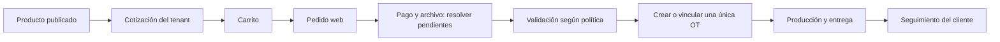

# GrafoCommerce — Plan maestro y documento vivo

**Última actualización:** 22 de septiembre de 2026

**Rama de desarrollo:** `codex/grafocommerce`

**Estado:** desarrollo pausado por decisión del usuario; se prioriza el onboarding de empresas. Investigación y prototipo conservados para retomar.

**Al retomar:** revisar el prototipo y acordar el recorrido de archivos, pago y aceptación antes de implementar la tienda. Aprovechar lo resuelto en onboarding y bibliotecas instalables.

## 1. Objetivo y acuerdos

### Conservación y reanudación

La rama `codex/grafocommerce` conserva este plan, el prototipo y su verificación en un commit local. No se elimina ni se fusiona con `main` en esta etapa. Su conservación remota requiere un push posterior. Para retomar, revisar este documento y GC-01 antes de escribir integraciones; la aprobación del prototipo no confirma todavía todas las decisiones operativas.

GrafoCommerce será un add-on para que cada empresa tenga una tienda web-to-print administrada desde Grafo. El cliente podrá configurar un trabajo, conocer su precio, adjuntar archivos y realizar un pedido que continúe dentro de la operación de esa empresa.

### Acordado con el usuario

- Nombre del proyecto: **GrafoCommerce**.
- Tienda propia por empresa, administrada dentro de Grafo.
- Catálogo y cotización conectados con los productos y el motor de cada empresa.
- Integración de los pedidos con las órdenes de trabajo.
- Una plantilla inicial, con posibilidad de incorporar otras en el futuro.
- Estética moderna y minimalista basada en la web actual de Grafo.
- Subdominio de Grafo, por ejemplo `corporearte.grafoprint.com.ar`, y posibilidad de conectar un dominio propio.
- Investigar referencias, empezando por Pixartprinting, y mantener este documento durante el desarrollo.

### Cómo leer este documento

**Acordado** expresa una decisión del usuario. **Propuesto** expresa una recomendación de producto o técnica todavía ajustable. **Pendiente** identifica una decisión sin cerrar. **Implementado** se usará sólo cuando exista código y evidencia de funcionamiento.

Las secciones siguientes son propuestas salvo que indiquen otro estado. El alcance del piloto, el proveedor de pagos, la infraestructura y el precio del add-on siguen pendientes.

## 2. Referencias investigadas

Revisión realizada el 22/09/2026 sobre páginas públicas oficiales. Pixartprinting se revisó también en navegador: portada y configurador de tarjetas. HelloPrint y 360imprimir se analizaron mediante el contenido público de sus fichas. No se realizaron compras, registros ni cargas de archivos; el funcionamiento posterior al pago se conoce sólo por sus explicaciones publicadas.

| Referencia | Observación | Aplicación propuesta en GrafoCommerce |
| --- | --- | --- |
| [Pixartprinting — portada](https://www.pixartprinting.es/) | Búsqueda destacada, navegación por familias, fotografías de aplicaciones y accesos a ayuda, cuenta y carrito. La portada dedica bastante espacio a promociones. | Catálogo fácil de encontrar, imágenes del producto y ayuda visible. Dar prioridad a categorías y productos de cada gráfica; los bloques promocionales serán opcionales. |
| [Pixartprinting — tarjetas](https://www.pixartprinting.es/tarjetas-de-visita/tarjetas-visita-estandar/) | Configuración visual de formato, papel y gramaje; resumen del trabajo; matriz de cantidades y fechas con precios. Distingue subir archivo, usar un editor y contratar diseño. La carga del archivo propio se plantea después del pedido. | Configuración guiada, resumen y total claros. Separar preparación del archivo de especificaciones del trabajo. La matriz de plazos quedará para cuando Grafo pueda calcular alternativas fiables. |
| [Pixartprinting — lonas](https://www.pixartprinting.es/formato-grande/impresion-lonas-microperforados/lona-frontlit/) | Admite medidas personalizadas y terminaciones como ojales, refuerzos y vainas. Sus instrucciones contemplan restricciones de fabricación. | Probar desde el principio un producto por medida, con unidades explícitas y combinaciones válidas. Los límites del proceso deben reflejarse en el formulario público. |
| [HelloPrint — tarjetas](https://www.helloprint.com/es-es/tarjetasdevisitaexclusivas) | Describe configuración, carrito editable, entrega y revisión del archivo. Explica que el plazo depende de recibir y aprobar el archivo dentro del horario previsto. Ofrece instrucciones y plantillas. | Mostrar qué falta para iniciar producción y de qué depende la fecha estimada. Vincular la guía de archivo con la configuración elegida. |
| [360imprimir — tarjetas](https://www.360imprimir.es/tarjetas-de-visita/imprenta) | Presenta alternativas para aportar un diseño propio, usar plantillas o solicitar ayuda de diseño. La página consultada indicaba indisponibilidad temporal. | Contemplar al comprador que tiene un PDF y al que necesita asistencia. El editor de diseño completo será una etapa posterior. No se verificó su checkout. |

**Conclusión de diseño:** conviene organizar la compra alrededor de tres preguntas: qué quiero producir, qué archivo voy a usar y cuándo estará listo. La propuesta de GrafoCommerce es conectar esas respuestas con el motor y la operación del tenant.

Las referencias orientan la interacción. Las imágenes, textos, iconografía y composición final serán propios o aportados por la empresa con derechos de uso. No se incorporarán promesas de validación automática, reseñas, descuentos ni plazos que Grafo no pueda respaldar.

## 3. Dirección visual

### Base existente verificada

La web de Grafo ya tiene una base adecuada en [globals.css de marketing](../apps/marketing/src/app/globals.css) y el sistema comparte colores en [brand-theme.module.css](../src/components/design-system/brand-theme.module.css):

| Uso | Base actual |
| --- | --- |
| Fondo general | `#f3f2ee` |
| Superficie | `#fbfaf7` |
| Texto | `#17191b` |
| Texto secundario | `#646668` |
| Líneas | `#deded7` |
| Superficie oscura | `#101214` |
| Acento Grafo | `#ff7546` |
| Tipografía | Geist; Geist Mono para información breve y técnica |

Propuesta: conservar tipografía, proporciones, líneas finas, espacios y controles simples. La **marca de la gráfica** protagonizará la tienda: logo, nombre, imágenes, contacto y contenido propios. La atribución a Grafo será discreta. La personalización de acento deberá respetar contraste y legibilidad.

### Composición inicial

- **Cabecera:** logo del tenant, catálogo, búsqueda, ayuda, pedidos y carrito. Navegación adaptable al tamaño del catálogo.
- **Inicio:** presentación breve, categorías, productos destacados, cómo comprar y datos reales de atención. Bloques editables con vista previa.
- **Listado:** tarjetas de producto con fotografía, nombre y descripción breve. Un precio «desde» deberá corresponder a una configuración y cantidad identificables.
- **Ficha:** imagen y descripción; opciones agrupadas; guía del archivo; resumen de configuración, importe y plazo. Ayuda contextual para términos técnicos.
- **Carrito:** filas compactas con configuración resumida, archivo y cantidad; posibilidad de editar sin empezar de nuevo.
- **Pedido:** progreso claro y una acción principal según lo pendiente: pagar, adjuntar archivo, revisar una prueba o consultar seguimiento.
- **Móvil:** recorrido vertical, controles cómodos y resumen accesible. Si se fija una barra inferior, tendrá espacio reservado para que no tape contenido.

La primera plantilla tendrá secciones y campos configurables. El editor libre de páginas, los scripts arbitrarios y la personalización irrestricta de CSS quedan fuera del piloto.

## 4. Recorridos propuestos

### 4.1 La empresa prepara su tienda

1. Activa GrafoCommerce y abre **Commerce → Configuración inicial**.
2. Define nombre, logo, contacto, dirección y subdominio.
3. Elige productos existentes para publicar. Revisa nombre público, imágenes, descripción, variantes y opciones permitidas.
4. Define condiciones de venta, precios aplicables, retiro/envío y política de archivos.
5. Conecta un medio de cobro o configura un proceso manual explícito para el piloto.
6. Hace un pedido de prueba y verifica su llegada a Grafo.
7. Publica la tienda. El dominio propio se conecta mediante un asistente cuando esa etapa esté habilitada.

Tener un producto en Grafo no lo publica automáticamente. Publicarlo exigirá una cotización válida y una configuración que pueda ejecutar la empresa.

### 4.2 El cliente compra

1. Encuentra un producto y elige medidas, cantidad y terminaciones.
2. El motor del tenant calcula el precio de esa combinación. La tienda muestra moneda, impuestos y condiciones de entrega.
3. Adjunta el archivo o elige una alternativa de asistencia permitida por ese producto.
4. Revisa el carrito, sus datos, retiro/envío y total final.
5. Confirma el pedido y completa el pago cuando corresponda.
6. Recibe una confirmación con acceso seguro a su pedido y los pasos pendientes.
7. La empresa valida el arte y el pedido avanza a producción conforme a su política.

**Propuesta para el piloto:** solicitar el archivo antes del pago en productos que lo requieran y permitir revisión manual de calidad. Los productos que necesiten diseño seguirán un recorrido de solicitud asistida; no se cobrarán como si estuvieran listos para producir. La posibilidad de pagar y adjuntar el archivo más tarde se definirá expresamente.

### 4.3 El pedido llega a Grafo

**Pedido web** registra el compromiso comercial y sus pendientes. La **OT** organiza la ejecución. Separarlos permite conservar una compra aunque el pago o el archivo requieran intervención.

Para el piloto se propone una aceptación operativa explícita que convierta el pedido en OT. Más adelante podrá automatizarse por producto cuando se cumplan condiciones definidas. Un pago confirmado no debe imprimir archivos ni dar por aprobado el arte automáticamente.

## 5. Interfaz de administración dentro de Grafo

| Sección | Qué podrá resolver la empresa |
| --- | --- |
| Inicio | Ver pedidos pendientes, estado de la tienda y problemas que requieren acción. |
| Pedidos web | Revisar pago, archivos, entrega, incidencias y OT vinculada. Filtrar por lo que falta resolver. |
| Catálogo | Publicar productos, elegir opciones válidas, ordenar categorías y editar contenido comercial. |
| Apariencia | Cambiar logo, imágenes, textos y bloques; previsualizar antes de publicar. |
| Cobros y entregas | Configurar medios de pago, retiro, zonas y tarifas de envío compatibles. |
| Dominio | Verificar y conectar una dirección propia; ver el estado de HTTPS. |
| Configuración | Gestionar políticas de archivos, notificaciones y permisos. |

El detalle de pedido reunirá configuración cotizada, versiones de archivo, movimientos de pago, comunicaciones relevantes y relación con la OT. Debe mostrar una acción operativa clara sin exigir navegar entre varias fichas.

## 6. Alcance propuesto del primer piloto

**Objetivo:** completar una compra real controlada, con precio correcto y trazabilidad hasta una OT, en una sola empresa de prueba.

### Incluido

- Una tienda por empresa, una plantilla y un idioma inicial.
- Subdominio administrado por Grafo; catálogo público y navegación por categorías.
- Publicación selectiva de productos y configuración guiada.
- Dos familias representativas: un producto de formato fijo, como tarjetas, y uno por medida, como lona. Los productos concretos se elegirán con datos válidos del tenant piloto.
- Carrito de varios ítems, moneda única por tienda y cálculo de impuestos conforme a la configuración aplicable.
- Compra como invitado, verificación de acceso al pedido y vinculación segura con clientes del tenant.
- Carga de PDF, validaciones básicas y revisión manual del arte.
- Retiro en local como entrega inicial; envío si se puede calcular y explicar su costo antes de confirmar.
- Un mecanismo de cobro completo: primero sandbox; activación real después de validar recepción, reintentos y conciliación.
- Pedido web, correos transaccionales, aceptación y conversión en OT, seguimiento y manejo de incidencias.

### Etapas siguientes

- Dominio propio con HTTPS automático: requisito del lanzamiento comercial, aunque no del primer piloto local.
- Documentos multipágina, planos CAD, panelizados y productos con más restricciones. En planos, respetar medidas y escala técnica.
- Gestión de pruebas digitales y aprobaciones con revisiones de archivo.
- Repetición de pedidos, cuentas de compradores y catálogos privados B2B.
- Más medios de pago, transportistas, idiomas y monedas.
- Editor de diseño online, personalización variable, maquetas 3D, cupones y varias plantillas.
- Matriz de precio/plazo y prioridad de producción, cuando exista capacidad para respaldar cada alternativa.

El motor puede ofrecer más funciones que las expuestas en la primera tienda. Habilitar una familia requiere verificar sus entradas, unidades, archivos, tiempos y salida hacia la OT.

## 7. Arquitectura propuesta y reutilización real

### Estructura

- **Frontend público específico**, con despliegue independiente del backoffice. Ubicación candidata: `apps/commerce`; todavía no creada.
- **Módulo Commerce en la API existente**, que coordine catálogo público, cotización, pedidos, pagos y dominios.
- **Servicios de dominio actuales** para calcular y crear órdenes; contratos públicos acotados para acceder a ellos.
- **Trabajos en segundo plano** para operaciones pesadas, correos y sincronización. El tráfico de una tienda deberá tener límites propios.
- Una misma aplicación atiende las tiendas; dominio y configuración determinan el tenant. No hace falta mantener una copia de la aplicación por gráfica.

Esta propuesta deberá contrastarse con el despliegue elegido. [La arquitectura de entornos documentada](despliegue-entornos-arquitectura.md) contiene propuestas y no acredita que toda esa infraestructura esté instalada.

### Componentes encontrados en el repositorio

| Base existente | Reutilización posible | Trabajo necesario |
| --- | --- | --- |
| [Productos y catálogo comercial](../apps/api/src/productos-servicios/productos-servicios.controller.ts), [formularios](../apps/api/src/productos-servicios/formulario-cotizacion.service.ts) y [recetas](../apps/api/src/productos-servicios/recetas-producto.service.ts) | Opciones, reglas y relación con productos del tenant. | Modelo de publicación, selección de opciones públicas y validación de combinaciones. El controlador actual tiene permisos internos, entre ellos `costos.ver`; no debe abrirse tal cual. |
| [Motor de cotización](../apps/api/src/motor-universal/motor.controller.ts) y [cola de cotizaciones](../apps/api/src/workers/cotizacion/cotizacion-jobs.service.ts) | Cálculo real y procesamiento asíncrono. | Adaptador público, límites de uso, cancelación de solicitudes obsoletas y respuesta sin costos, márgenes ni datos internos. |
| [Órdenes de trabajo](../apps/api/src/ordenes-trabajo/ordenes-trabajo.controller.ts) | Alta y seguimiento operativo. | Pedido web, aceptación, conversión idempotente y trazabilidad del origen. |
| [Archivos](../apps/api/src/archivos/archivos.service.ts) y [desarrollo documental](../apps/api/src/desarrollo-documental/desarrollo-documental.service.ts) | Almacenamiento y versiones de documentos. | Carga pública limitada, validación, pertenencia al pedido y acceso seguro para compradores. |
| [Previsión de materiales](../apps/api/src/inventario/prevision-materiales.service.ts) y [planificación de cotización](../apps/api/src/planificacion-entregas/planificacion-cotizacion.controller.ts) | Consultar disponibilidad y estimaciones. | Traducir resultados a mensajes comerciales y auditar su fiabilidad para cada familia publicada. |
| [Capacidades de empresa](../apps/api/src/suscripciones/capacidades-empresa.service.ts) y [catálogo de planes](../apps/api/src/plataforma/planes/catalogo-planes.ts) | Control de acceso al add-on y dependencias. | Definir capacidades Commerce y su contratación. No se ha decidido incluirlo en ningún plan actual. |
| [Base de correos](../apps/api/src/registro/plantillas/correo-base.ts) | Estructura y estética transaccional. | Plantillas de comprador, identidad del tenant, remitente y seguimiento de entregas. |

Encontrar estos servicios reduce trabajo, pero no acredita que admitan tráfico público anónimo ni todos los recorridos de Commerce. Se verificará cada integración antes de marcarla como terminada.

### Entidades de trabajo sugeridas

`Tienda`, `DominioTienda`, `ProductoPublicado`, `CotizacionWeb`, `PedidoWeb`, `ItemPedidoWeb`, `ArchivoPedidoWeb`, `IntentoPago` y `EventoPedidoWeb`.

Son nombres conceptuales, no un esquema aprobado. La definición técnica deberá resolver versiones de publicación, retención y las referencias a entidades existentes, evitando duplicar maestros de productos, clientes y materiales.

## 8. Reglas que deben sostener el recorrido

### Catálogo, precios y fechas

- Producto y opciones publicados forman una lista permitida. El servidor rechaza parámetros, descuentos o variantes que el comprador no pueda elegir.
- El tenant se resuelve por una tienda válida; un `tenantId` enviado por el comprador no decide a qué empresa pertenece la operación.
- El navegador solicita un cálculo. El servidor conserva referencia, vigencia y versión de la cotización; el importe enviado por el navegador nunca es autoridad de cobro.
- Antes de confirmar se verifica precio y vigencia. Si algo cambió, el comprador ve el nuevo total y lo acepta. Un pedido confirmado conserva su configuración e importe histórico.
- El carrito no reserva stock indefinidamente. La reserva se aplicará en un momento explícito, reutilizando la política de órdenes y liberando lo correspondiente al cancelar.
- La falta de stock puede permitir comprar con reposición estimada, solicitar presupuesto o suspender venta, según el producto. La política se mostrará antes de pagar.
- La fecha debe distinguir **producción lista** de **entrega al cliente**. Considerará material, capacidad, recepción/aprobación del archivo y transporte; si falta un dato, mostrará una estimación condicionada o solicitará confirmación.
- No publicar una tabla de entregas alternativas mientras no haya una regla fiable que calcule cada opción.

### Pago, archivo y OT

- El estado del pago, del archivo y de producción se guarda por separado. «Pagado» puede convivir con «Archivo pendiente de revisión».
- Un PDF válido técnicamente puede ser incorrecto para imprimir. La revisión básica no equivale a aprobación de sangrado, resolución, color o contenido.
- Cada ítem conserva sus archivos, configuración y revisión aprobada. Un reemplazo posterior a la aceptación exige controlar su impacto sobre precio, fecha y OT.
- El retorno del checkout es informativo. El pago se confirma mediante eventos verificados y conciliación con el proveedor.
- Reintentos del comprador, webhooks duplicados y fallas de red no deben duplicar pagos registrados ni OTs. Las operaciones externas necesitan estados persistentes y recuperación.
- El piloto vinculará un pedido a una OT con varios ítems. Dividir una compra en varias OTs o entregas queda como ampliación explícita.
- Si el pago se confirma y falla la creación de la OT, el pedido conserva el pago y queda visible para reintento o intervención. Nunca debe desaparecer ni pedirse otro pago para recuperarlo.
- Cancelaciones y devoluciones necesitan reglas para pagos, reservas y producción ya iniciada; deben definirse antes de aceptar dinero real.
- El cobro de la suscripción de Grafo y el cobro de ventas del tenant son relaciones distintas. La integración actual con Paddle no resuelve por sí sola el checkout de las gráficas.

### Aislamiento y rendimiento

- Archivos privados con acceso limitado al comprador y personal autorizado; validación de tipo, tamaño, cuotas y pertenencia. Las subidas abandonadas requieren limpieza y una política de retención.
- Cookies de administración separadas de las tiendas; un dominio de un tenant no recibe sesiones administrativas compartidas.
- Compradores separados de usuarios internos; no consumen automáticamente los cupos de 3, 20 o 40 usuarios de los planes.
- Verificar identidad antes de mostrar pedidos anteriores o vincular una compra con una cuenta existente. Conocer un correo no concede acceso a sus pedidos.
- Caché de contenido público por tienda y versión; cálculos con contexto de tarifas. La cola actual evita reutilizar cotizaciones terminadas indiscriminadamente porque los precios pueden cambiar.
- Limitar cotizaciones simultáneas y frecuencia de actualización por tienda/sesión. Las tareas costosas no pueden monopolizar el motor del SaaS.
- Medir tiempo de cálculo, errores, abandono, conversiones, almacenamiento y carga por tenant antes de definir límites comerciales.

## 9. Dominios propios y publicación

**Experiencia propuesta:** la empresa escribe su dominio, recibe registros DNS para copiar o compartir con su proveedor, y Grafo informa el avance hasta quedar activo.

Estados visibles: **Pendiente de configuración → Verificando dominio → Preparando HTTPS → Activo**, con errores explicados y posibilidad de reintentar.

[Cloudflare for SaaS](https://developers.cloudflare.com/cloudflare-for-platforms/cloudflare-for-saas/start/getting-started/) es un candidato: permite registrar hostnames por API y gestionar certificados. Su documentación distingue activación del hostname, estado del certificado y DNS dirigido al destino del SaaS; los tres deben estar correctos. El proveedor definitivo se decidirá junto con el despliegue y sus costos.

Decisiones técnicas propuestas:

- Subdominio gratuito de Grafo para cada tienda; slug único y nombres de infraestructura reservados.
- Dominio propio exclusivo y verificado antes de activarlo; un hostname desconocido no debe caer en la tienda de otra empresa.
- Comenzar la conexión propia por un subdominio, como `tienda.empresa.com`; estudiar soporte del dominio raíz según proveedor DNS y plataforma.
- Dominio principal explícito, redirecciones seguras y URLs canónicas para evitar duplicación en buscadores.
- Borradores y vistas previas fuera de indexación. Generar sitemap y metadatos sólo de productos publicados.
- Cambios, bajas y reasignaciones deben retirar vínculos anteriores y exigir nueva verificación de titularidad cuando corresponda.
- El correo saliente tendrá su propio proceso de autenticación. Conectar el dominio web no habilita automáticamente el envío de correo con esa dirección.

## 10. Add-on, permisos y continuidad

Propuesta inicial: activar Commerce como capacidad independiente, con dependencias explícitas sobre catálogo, cotización, archivos y órdenes. La impresión directa mediante QZ no será requisito para recibir pedidos web.

Separar permisos para editar contenido, publicar, configurar cobros/dominios y gestionar pedidos. Registrar quién modifica condiciones comerciales o convierte un pedido en OT.

Al desactivar el add-on, cerrar nuevas compras conforme a una política visible y conservar la gestión de pedidos ya aceptados. Suspensión por impago, baja de tienda y eliminación de datos son procesos diferentes; deberán definir acceso al seguimiento y retención.

**Pendiente comercial:** precio, implementación inicial, planes compatibles, cantidad de tiendas/dominios, almacenamiento, tráfico de cotización y eventual comisión. No se establecen importes ni cobros en esta etapa.

## 11. Etapas y criterios de salida

| Etapa | Entregable | Se considera terminada cuando… | Estado |
| --- | --- | --- | --- |
| GC-00 — Base | Investigación, rama y documento vivo. | Existen referencias verificadas, decisiones identificadas y recorrido inicial. | Completada el 22/09/2026. |
| GC-01 — Experiencia | Prototipo de inicio, ficha, carrito, pedido y administración mínima. | Podemos recorrer formato fijo y medidas personalizadas, en escritorio y móvil; quedan acordados los pasos de archivo/pago/aceptación. | Prototipo disponible y recorrido verificado; pendiente de revisión con el usuario. |
| GC-02 — Tienda y catálogo | Módulo, permisos, tienda y publicación versionada. | Dos tenants de prueba ven sólo sus productos publicados; preview y publicación funcionan; el add-on se controla desde el servidor. | Pendiente. |
| GC-03 — Cotización y pedido | Configurador conectado, carrito, archivos y pedido persistido. | Un cálculo coincide con Grafo, valida opciones/precio y conserva el pedido ante interrupciones; compradores y archivos quedan aislados. | Pendiente. |
| GC-04 — Cobro y operación | Un checkout, eventos de pago, correos y conversión a OT. | Pago confirmado genera el estado correcto; duplicados/fallas se recuperan; aceptación, cancelación y devolución tienen recorrido probado. | Pendiente. |
| GC-05 — Piloto y lanzamiento | Prueba controlada, dominios, HTTPS, observabilidad y soporte. | Compra a entrega validada, pruebas de aislamiento y carga aprobadas, costos medidos y onboarding reproducible por una empresa. | Pendiente. |
| GC-06 — Ampliaciones | Familias complejas, B2B, diseño online, logística y nuevas plantillas. | Cada ampliación tiene alcance y criterios propios; no se promete antes de verificarse. | Backlog. |

La verificación de infraestructura y del proveedor de pago debe iniciarse durante GC-01 para evitar diseñar una experiencia que luego no podamos soportar. GC-05 incluye dominio propio antes de ofrecerlo comercialmente.

## 12. Decisiones pendientes

| ID | Decisión | Recomendación inicial | Resolver antes de |
| --- | --- | --- | --- |
| D-01 | Productos y tenant piloto. | Una familia de formato fijo y una por medida, con recetas y costos validados. | GC-01. |
| D-02 | Cuándo exigir archivo. | Antes del pago para impresión directa; recorrido asistido para diseño. | Cierre de GC-01. |
| D-03 | Cuándo convertir a OT. | Aceptación operativa en el piloto, luego automatización configurable. | Diseño de GC-03. |
| D-04 | País, moneda y proveedor de pagos. | Una combinación inicial; cada gráfica debe recibir sus ventas bajo un modelo de cobro definido. | Inicio de GC-03. |
| D-05 | Política de precios web. | Reutilizar motor y establecer una política comercial de canal explícita. Definir precio público, impuestos y vigencia. | GC-03. |
| D-06 | Entrega y capacidad. | Retiro inicial y estimación condicionada; ampliar envíos con costo y plazo verificables. | GC-03. |
| D-07 | Archivos y asistencia. | PDF inicial, límites configurados y revisión manual; definir quién asume diseño/corrección. | GC-03. |
| D-08 | Dominio e infraestructura. | Frontend independiente y proveedor que automatice HTTPS y verificación. | Inicio de GC-02. |
| D-09 | Cancelaciones, devoluciones y condiciones. | Política de cada gráfica compatible con el flujo y con revisión aplicable al mercado elegido. | Pruebas de pago real. |
| D-10 | Add-on y continuidad. | Comercialización independiente; pedidos históricos accesibles al personal autorizado. | Piloto externo. |
| D-11 | Identidad y contenido. | Marca del tenant sobre estructura visual Grafo; edición por bloques y publicación con preview. | GC-01. |

Estas decisiones no bloquean la investigación ni el prototipo. Se resolverán con ejemplos concretos al entrar en su etapa.

## 13. Verificación de punta a punta

Antes de abrir el piloto se deberán demostrar, como mínimo:

- Igual configuración produce el mismo resultado económico bajo la política comercial elegida; unidades, redondeos, moneda e impuestos quedan explicados.
- Un visitante no puede comprar un producto no publicado ni forzar variantes, descuentos o empresas ajenas.
- Una cotización vencida o un producto modificado muestra revisión de precio y no cobra silenciosamente otro importe.
- Dos compras simultáneas respetan las reglas de stock/plazo; una promesa condicionada no aparece como garantizada.
- Pago aprobado, rechazado, pendiente y cancelado; evento repetido, evento tardío y caída temporal de la API tienen resultados recuperables.
- Un pedido confirmado se vincula a una sola OT; archivos y especificaciones llegan completos y conservan sus versiones.
- Un archivo incorrecto detiene la aceptación correspondiente y ofrece una acción comprensible al cliente.
- Compradores, dominios, sesiones, cachés y archivos no se mezclan entre tenants.
- El flujo funciona en móvil y con teclado; validaciones y elementos fijos no ocultan opciones ni importes.
- La empresa puede operar pendientes y devoluciones, recibir correos y cerrar temporalmente ventas sin perder pedidos aceptados.
- Las pruebas de carga miden cotizaciones concurrentes y procesamiento de archivos sin degradar la operación interna. Los umbrales se fijarán con mediciones, no con supuestos de capacidad.

## 14. Mantenimiento del documento

En cada etapa se actualizarán estado, decisiones tomadas, alcance afectado y evidencia: enlaces a implementación, pruebas y observaciones del piloto. Los cambios de alcance deben verse aquí antes de presentarse como funcionalidad disponible.

| Fecha | Cambio | Evidencia / siguiente acción |
| --- | --- | --- |
| 22/09/2026 | Creación de rama y plan; revisión de Pixartprinting, HelloPrint y 360imprimir; relevamiento inicial de servicios Grafo. | Fuentes en §2 y archivos en §7. Siguiente: prototipo del recorrido GC-01 y selección de productos piloto. |
| 22/09/2026 | Primer prototipo navegable: tarjetas y lona por medida, carrito editable, archivo de ejemplo, pago simulado, recepción en Grafo, aprobación y OT de prueba. | [Fuente del prototipo](prototipos/grafocommerce-prototipo.html) y [alcance y verificación](prototipos/grafocommerce-prototipo.md). Revisar la propuesta con el usuario; precios, datos y estados son de muestra. |

**Estado de implementación:** existe un prototipo de interfaz aislado, sin llamadas a la API. No hay migraciones, endpoints, cobros, pedidos reales ni cambios en planes. Ninguna capacidad comercial de GrafoCommerce se considera habilitada todavía.
